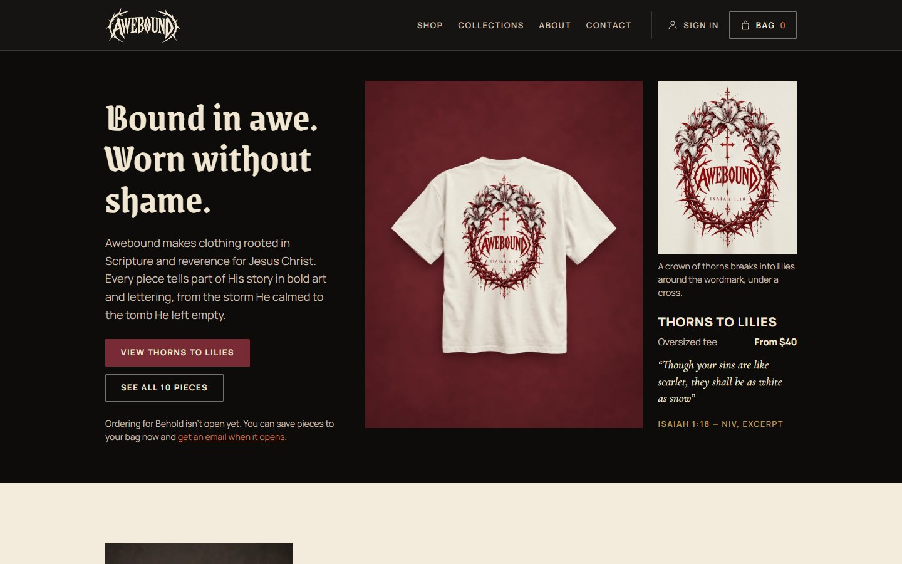
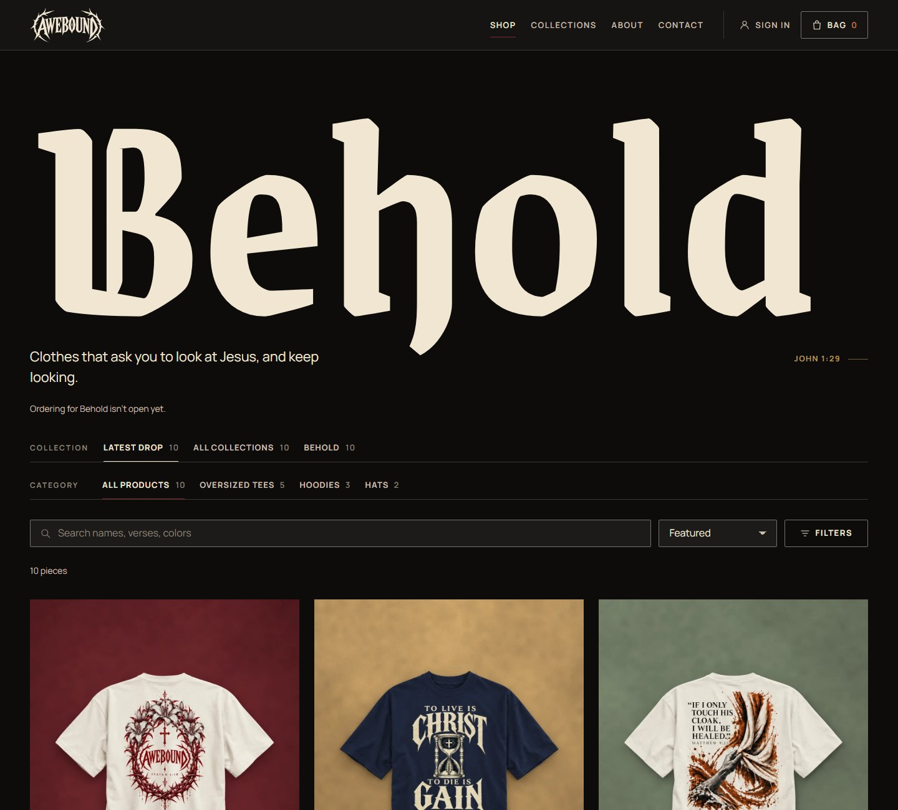

# Awebound

The website and store for **Awebound**, an independent Christian apparel brand founded by Richard out of his faith, open to anyone who likes the artwork or wants to know what's behind it. Awebound makes clothing rooted in Scripture and reverence for Jesus Christ; every design tells a story about Him and carries its full Scripture reference. Release 01 is **Behold**: five oversized tees, three hoodies and two caps, ten pieces that ask you to look at Jesus and keep looking.



## What's here

| Area                    | What it does                                                                                                                                                                                                                                                                                                                                                                                                                                                                                                                                                                                                                                                                                                                                                                                                                                                                         |
| ----------------------- | ------------------------------------------------------------------------------------------------------------------------------------------------------------------------------------------------------------------------------------------------------------------------------------------------------------------------------------------------------------------------------------------------------------------------------------------------------------------------------------------------------------------------------------------------------------------------------------------------------------------------------------------------------------------------------------------------------------------------------------------------------------------------------------------------------------------------------------------------------------------------------------ |
| **Home**                | The tagline at poster size and two buttons (to the piece on screen and to the whole release) on that piece's own color plate, with the garment cut out beside them. Every visit opens on the release's primary piece (Thorns to Lilies in Behold), then the pieces take turns every few seconds while the plate is on screen: the plate cross-fades and the garment fades out before the next fades in (Previous, Pause and Next under the buttons, or a sideways swipe on a phone; still with reduced motion). Then the brand paragraph and the piece on the plate up close, following it (a close-up of its print, its name, price and verse), Richard's portrait and his note in his own words, the latest release under its name as a wall of its pieces, and a short My Archive section with one button. No labels above headings; on phones the buttons come before the image. |
| **Shop**                | The release's name across the width, then a short search box (names, verses, colors) and one compact row: a collection select (All collections, the default, then each release), a category select (All products, Tees, Oversized tees, Hoodies, Hats), sort and a filter sheet (color, size, price); chips and an empty state with a reset. Each card carries its verse and a save heart; on a phone, swiping a card's image shows the piece's other images without opening it. State lives in the URL, so every view is shareable. While there is one release, `/collections` opens the shop; `/collections/<slug>` opens it filtered to that release.                                                                                                                                                                                                                             |
| **Product pages**       | The stage: the product's images filling the left of the page (swipe on phones), with a 2× zoom on hover or press-and-hold to see the print up close. Beside it the name, garment type and price, its KJV verse, color and size with the size guide for the piece's blank, Add to bag (with a note when a 2XL or 3XL costs more), and delivery and returns in brief. Below: the design story on the piece's plate, product details, the previous and next pieces, and the rest of the release. A tile's image travels into the stage when you open a piece; on phones the price and button stay in a bar at the bottom.                                                                                                                                                                                                                                                               |
| **Bag and checkout**    | A persisted bag drawer that re-prices on the server. Checkout hands the pieces that can be ordered to Fourthwall's hosted checkout, which takes payment, prints and ships; the site holds no payment code. Until a piece is published in Fourthwall the site still looks ready, but checkout shows a try-again message; a bag saved before publishing carries over.                                                                                                                                                                                                                                                                                                                                                                                                                                                                                                                  |
| **About, Contact, FAQ** | Richard's story in his own words, what “bound in awe” means, how reverence shapes the work, and how every design is made; a contact form that is stored and emailed to `contact@awebound.store` (replies within 72 hours); answers to common questions.                                                                                                                                                                                                                                                                                                                                                                                                                                                                                                                                                                                                                              |
| **Policies**            | Returns and refunds (Fourthwall's policy: damage, misprints, defects and wrong items or sizes reported within 30 days of delivery), privacy policy and terms of service, drafted for review.                                                                                                                                                                                                                                                                                                                                                                                                                                                                                                                                                                                                                                                                                         |
| **Accounts**            | Passwordless only: Google, or a one-time email link or code. Guest checkout stays open to everyone. A free account opens My Archive: pieces saved with the heart, linked orders with their pieces and quantities, and for every purchased design its full story, founder note, wallpapers, design card PDF and story images; the first 50 registered buyers get a Founding Member seal. Owner pages review and publish the content. See [docs/ARCHIVE.md](docs/ARCHIVE.md).                                                                                                                                                                                                                                                                                                                                                                                                          |

Scripture on the website is quoted from the King James Version through one shared record per piece, the same wording the printed designs use. Product images are Fourthwall's renders of each product (exactly what will be made), placed on each piece's own surface by `assets/mockups`, which also makes each piece's plate (that surface as a full-bleed field). About carries Richard's portrait and his story in his own words; the footer ends with the wordmark.



## Stack

| Layer             | Choice                                                                                                                                                                                                   |
| ----------------- | -------------------------------------------------------------------------------------------------------------------------------------------------------------------------------------------------------- |
| App               | One Next.js 16 app (App Router, Turbopack, Server Components and Server Actions), React 19 (its view transitions for the morph between a tile and its product page), Tailwind CSS 4, zustand for the bag |
| Commerce          | Fourthwall: live catalog (Storefront API), hosted checkout, payment and fulfillment                                                                                                                      |
| Database and auth | Supabase: Postgres with row-level security (profiles, contact messages, sign-ups), Supabase Auth (Google OAuth + email OTP)                                                                              |
| Email             | Resend: transactional mail from the server, and SMTP for Supabase Auth emails                                                                                                                            |
| Brand             | `packages/brand` (tokens, components, the wordmark and Thorn Cross as SVG); rules in `docs/BRAND.md` and the `awebound-brand` skill                                                                      |

```
awebound/
├─ apps/web          the site: pages, server code (src/server), schemas (src/shared)
├─ packages/brand    tokens, CSS, React components, SVG marks
├─ packages/tsconfig shared compiler settings
├─ supabase          migrations, auth email templates, CLI config
└─ docs              ARCHITECTURE.md, DEPLOYMENT.md, TODOS.md
```

## Run it locally

Requirements: Node 22 and pnpm 10 (`corepack enable` picks up the pinned version).

```bash
pnpm install
cp apps/web/.env.example apps/web/.env.local   # then fill in the values
pnpm dev
```

Open http://localhost:3000. `apps/web/.env.example` lists every variable with a comment.

The catalog and checkout come from the Fourthwall shop when `FOURTHWALL_STOREFRONT_TOKEN` is set (Fourthwall admin → Settings → For developers). The pieces themselves (releases, stories, Scripture, images) live in Supabase and are added from the owner's Admin pages, one zip per garment, with `apps/web/src/server/content/catalog.json` as the fallback. Published pieces that aren't in Fourthwall yet, or all of them without a token, look ready to order with the site's prices and images, but checkout shows a try-again message until they're published.

Without Supabase keys accounts show "open soon" and contact messages and back-in-stock requests aren't stored; without `RESEND_API_KEY` emails print to the terminal in development.

### With a local Supabase

```bash
supabase start          # local Postgres, Auth and a mail catcher (needs Docker)
supabase db reset       # applies supabase/migrations
```

Then point `NEXT_PUBLIC_SUPABASE_URL`, `NEXT_PUBLIC_SUPABASE_PUBLISHABLE_KEY` and `SUPABASE_SECRET_KEY` in `apps/web/.env.local` at it. Sign-in emails land in the local mail catcher at http://localhost:54324.

## Scripts

| Command          | What it does                                     |
| ---------------- | ------------------------------------------------ |
| `pnpm dev`       | The site in watch mode                           |
| `pnpm build`     | Production build of every package                |
| `pnpm start`     | Run the built site                               |
| `pnpm typecheck` | Type-check every package                         |
| `pnpm lint`      | ESLint everywhere (Next's rules for the web app) |
| `pnpm format`    | Prettier                                         |

There are no automated tests in this repo, by design. Changes are verified with `typecheck`, `lint`, `build` and by running the flows in a browser.

## Deploy

One Vercel project with Root Directory `apps/web`. Steps, variables and DNS: [docs/DEPLOYMENT.md](docs/DEPLOYMENT.md).

## Status

Built: every page, the shop and its filters, product pages, bag, contact, sign-up, sign-in screens.

Commerce: Fourthwall (live catalog and hosted checkout), always on. Next steps are at the top of [docs/TODOS.md](docs/TODOS.md): Vercel variables, retiring the old API project, resetting the Supabase database, and publishing the products in Fourthwall. Still waiting on prices and photography, Google / Resend setup and a legal review of the policies.

## Docs

- [docs/ARCHITECTURE.md](docs/ARCHITECTURE.md): how the app is put together, data flow, auth and email, schema, and the Fourthwall integration
- [docs/DEPLOYMENT.md](docs/DEPLOYMENT.md): the Vercel project, environment variables, domains
- [docs/TODOS.md](docs/TODOS.md): decisions, setup steps and remaining work
- [docs/ARCHIVE.md](docs/ARCHIVE.md): My Archive, the owner guide, the Founding policy, setup and the readiness report
- [AGENTS.md](AGENTS.md) and the `AGENTS.md` in each app and package: context and rules for coding agents
