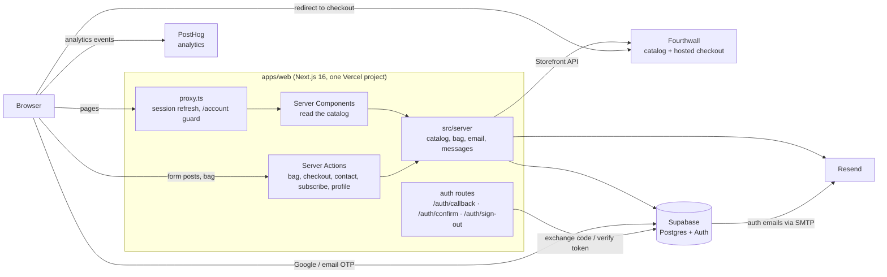
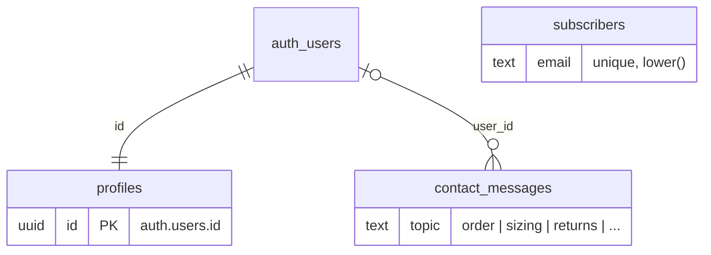
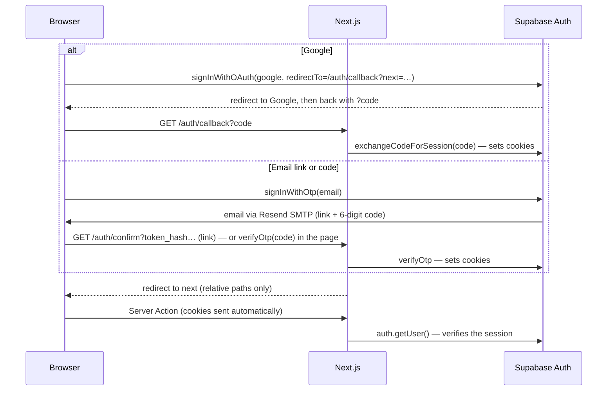

# Architecture

How the Awebound site is put together, why, and where to change things. Written for the owner and for coding agents; keep it current when structure changes.

## System overview

- **One Next.js app** does everything. Server Components read the catalog directly from server code. The browser reaches the server only through Server Actions. There is no separate API.
- **Fourthwall** supplies live products, prices, stock and photos, and runs checkout, payment and fulfillment.
- **Supabase** runs authentication and stores profiles, contact messages, drop-note sign-ups, My Archive's data and idea submissions.
- **Resend** delivers all email: auth emails (via Supabase's SMTP setting) and the site's transactional mail.
- **PostHog** receives the browser's analytics events (see Analytics). Nothing is sent while its token is unset.

## Workspace

| Package             | Depends on   | Notes                                                              |
| ------------------- | ------------ | ------------------------------------------------------------------ |
| `packages/tsconfig` | –            | Base, library and Next.js compiler settings                        |
| `packages/brand`    | react (peer) | Tokens, component CSS, Tailwind theme, typed components, SVG marks |
| `apps/web`          | brand        | The site. Next compiles `packages/brand` via `transpilePackages`   |

## Server code (`apps/web/src/server`)

Plain modules, one per job. Everything here is server-only; Client Components import only `actions.ts`.

| File                                     | Does                                                                                                                       |
| ---------------------------------------- | -------------------------------------------------------------------------------------------------------------------------- |
| `actions.ts`                             | The Server Actions (below). Parse input with `src/shared` schemas, read the user from the session, return `Result<T>`.     |
| `catalog.ts`                             | `getCatalog()` (Fourthwall + brand content, once per request), `searchProducts`, `getFacets`, `getProduct`, `withFallback` |
| `catalog-merge.ts`                       | Merges Fourthwall products with the brand content by slug                                                                  |
| `catalog-search.ts`                      | Search, filters, facets (each ignores its own filter) and sorting over the merged catalog                                  |
| `fourthwall.ts`                          | Storefront API client: product list (cached 60 s by Next's data cache), cart creation                                      |
| `bag.ts`                                 | Re-prices a bag from the catalog; creates the Fourthwall cart and checkout URL                                             |
| `messages.ts`                            | Contact messages and drop-note sign-ups: store in Supabase, email through Resend                                           |
| `account.ts`                             | Account deletion: drop-notes row, sign-in and profile, then a confirmation email                                           |
| `email.ts`                               | `sendEmail()`: Resend with the wordmark attached inline, or the terminal in development; fails in production without a key |
| `email-templates.ts`                     | One table layout for every email, and the transactional templates                                                          |
| `errors.ts`                              | `UserError` (a message safe to show), `Result<T>`, `run()`, `parse()`                                                      |
| `env.ts`                                 | Server-only env (zod)                                                                                                      |
| `indexable.ts`                           | `indexablePages()`: every address search engines should index. The sitemap and IndexNow both read it                       |
| `indexnow.ts`                            | `syncIndexNow()`: sends IndexNow the pages that are new, changed or gone (below); `indexNowDates()` for the sitemap        |
| `cron.ts`                                | `cronDenied()`: the `CRON_SECRET` bearer check shared by the cron routes                                                   |
| `session.ts`                             | The signed-in shopper from the session cookies                                                                             |
| `limit.ts`                               | Sliding-window rate limits per IP or per user, in memory                                                                   |
| `scripture.ts`                           | The Scripture records and the translation the website quotes (KJV)                                                         |
| `archive-actions.ts`, `admin-actions.ts` | My Archive's Server Actions and the owner's (below)                                                                        |
| `archive/`                               | My Archive: designs, orders, entitlements, Founding, wallpapers, ideas, readiness and the offer ([ARCHIVE.md](ARCHIVE.md)) |
| `content/`                               | The brand story per product, read from Supabase; `catalog.json` is the fallback and holds categories and color tokens      |
| `catalog-admin/`                         | The owner's catalog: collections, piece zips, the review page, publishing (below); actions in `catalog-admin-actions.ts`   |
| `refresh.ts`                             | `refreshPublicPages()`: the catalog and Archive tags, every cached page, then IndexNow                                     |

`src/shared` holds the zod schemas, types and helpers (`formatPrice`, `colorCss`) used on both sides. `src/lib/supabase` has the browser, server (cookie session) and admin (secret key) clients.

### Server Actions

| Action             | Input               | Notes                                                                                                                 |
| ------------------ | ------------------- | --------------------------------------------------------------------------------------------------------------------- |
| `validateBag`      | `{ lines }`         | Re-prices lines from the catalog, merges duplicates, caps quantity at 10, flags sold-out and missing items            |
| `startCheckout`    | `{ lines }`         | Creates a Fourthwall cart from the available lines; returns `{ url }`. Links the signed-in user. 30 per 10 min per IP |
| `loadMoreProducts` | shop query + `page` | "Show more" in the shop grid                                                                                          |
| `sendContact`      | contact form        | Stores, emails the inbox (reply-to sender), acknowledges. Honeypot field `website`. 5 per 10 min per IP               |
| `subscribe`        | `{ email, source }` | Never reveals whether an address was already subscribed. 10 per 10 min per IP                                         |
| `updateProfile`    | `{ fullName }`      | Signed-in users only                                                                                                  |
| `deleteAccount`    | –                   | Signed-in users only. Removes the sign-in, profile and drop-notes row, emails a confirmation, clears the session      |

My Archive adds `savePieceAction`, `unsavePieceAction`, `getSavedSlugsAction` (one call per page load, shared by every save heart through `features/archive/saved-store.ts`), `designAccessAction`, `startOrderClaim`, `verifyOrderClaim`, `refreshMyOrders`, `setEmailConsent`, `startIdeaUploadAction`, `submitIdeaAction` (`archive-actions.ts`) and the owner's actions in `admin-actions.ts`, which first require the `admin` role from `user_roles`.

Every action returns `{ ok: true, data }` or `{ ok: false, error, fields? }`. Next hides thrown error messages in production, so messages meant for the shopper are thrown as `UserError` and come back as values; anything else is logged and becomes a generic message.

## Data model (Supabase)

- The catalog is not in Postgres: Fourthwall supplies it (see "Fourthwall" below).
- **My Archive** adds server-only tables (RLS on, no policies, `service_role` grants): `saved_pieces`, `fit_preferences` (unused; a later migration can drop it), `archive_designs` + `archive_design_content` (versioned content; the public preview and context are the only fields public pages read), `archive_assets` (wallpapers in the private `archive-assets` bucket), `checkout_sessions` (the cart id of every checkout and who was signed in), `provider_orders` + `provider_order_lines` (Fourthwall's orders as the canonical record), `webhook_events`, `reconciliation_runs`, `order_claims`, the `archive_entitlements` view (paid, real, ordinary orders by design), `founding_members` + `founding_candidates` with `archive_award_founding()`, `feature_flags`, `email_consents`, `email_outbox`, `owner_audit_log`, `user_roles`, `idea_submissions` (images in the private `idea-submissions` bucket). `indexnow_pages` (server-only too) records each page's fingerprint when IndexNow was last told about it. `profiles` follows `auth.users` (email and `email_verified_at` by trigger) and a user may update `full_name` only.
- **Row-level security** is on for every table. Profiles are readable and writable only by their owner (the account page reads with the user's session). `contact_messages` and `subscribers` have no policies at all, so only the server's secret key can touch them.
- **Profiles** are created by the `on_auth_user_created` trigger (name and avatar from Google when present). `updateProfile` upserts, so a user without a row still works.
- **Deleting an account** (`/account`) deletes the auth user, which cascades to `profiles` and `idea_submissions` (their images are removed from the `idea-submissions` bucket first) and sets `contact_messages.user_id` to null (messages stay as support history), and removes the `subscribers` row with the same email.

## Auth

- Sessions live in cookies managed by `@supabase/ssr`. `src/proxy.ts` (Next 16's proxy, which runs before rendering) refreshes them on each request and redirects signed-out visitors away from `/account`.
- Server code never trusts a user id from the input; it reads the user from the session.
- Without `NEXT_PUBLIC_SUPABASE_*` the site shows "Accounts open soon" and keeps guest checkout.

## Email

| Email                                                                                       | Sent by                           | Template                                 |
| ------------------------------------------------------------------------------------------- | --------------------------------- | ---------------------------------------- |
| Sign-in link and code, confirm email, confirm new email                                     | Supabase Auth through Resend SMTP | `supabase/templates/*.html`              |
| Contact notification to `contact@awebound.store` (reply-to sender)                          | Server → Resend                   | `apps/web/src/server/email-templates.ts` |
| Contact acknowledgement                                                                     | Server → Resend                   | same                                     |
| Drop-notes welcome                                                                          | Server → Resend                   | same                                     |
| Account deleted                                                                             | Server → Resend                   | same                                     |
| Idea submission to `ideas@awebound.store` (image attached)                                  | Server → Resend                   | same                                     |
| Order claim code                                                                            | Server → Resend                   | same                                     |
| Archive welcome, design unlocked, collection update (outbox, each behind an `email.*` flag) | Server → Resend                   | same                                     |
| Guest follow-up, cart reminder (outbox, `email.*` flags; daily follow-ups cron)             | Server → Resend                   | same                                     |

Every email shares one table layout (`layout` in `email-templates.ts`; the three Supabase files copy its markup): the oxblood wordmark on warm bone, a paper card, inline hex colors (email clients ignore CSS variables and strip SVG), and only widely supported CSS (no styles on `<body>`, no margins, no rounded corners). The site attaches the wordmark inline (`cid:wordmark`), so it shows without loading a hosted image; Supabase emails load `{{ .SiteURL }}/email/wordmark-oxblood.png`. Check changes with Mailpit's HTML check (`supabase start`, then http://localhost:54324).

## Bag and checkout

1. The bag lives in the browser (zustand, persisted to localStorage, keyed by SKU).
2. Whenever the bag is shown, the `validateBag` action re-prices it. The client's prices are display copies only.
3. **Check out** calls `startCheckout`, which re-reads the bag from the catalog, creates a Fourthwall cart from the available lines and answers `{ url }`; the browser goes to Fourthwall's hosted checkout.
4. Fourthwall never sends the buyer back (its confirmation page is the end of checkout), so a guest's browser keeps the cart id (`awebound-guest-checkouts` in localStorage). On their next visit, once the webhook has recorded the paid order, a band under the header (`GuestOrderNotice`) invites them into My Archive; the next morning one email does the same (`docs/ARCHIVE.md`, Discovery and Order pipeline).

### Fourthwall

Fourthwall takes payment, prints and ships, and sends order emails, so the site needs no payment code. My Archive keeps a copy of each order from Fourthwall's webhooks and Open API (`provider_orders`) to link it to an account; the cart created at checkout is recorded in `checkout_sessions` and matched to the order's `checkoutId`. Route handlers: `POST /api/fourthwall/webhook`, `GET /api/fourthwall/reconcile` (cron), `GET /api/archive/follow-ups` (cron: the guest follow-up and cart reminder emails), `GET /api/archive/assets/[assetId]`, `GET /api/archive/designs/[slug]/card.pdf` and `share.png`. Without `FOURTHWALL_STOREFRONT_TOKEN` every piece is a preview (below).

- **Catalog**. `server/fourthwall.ts` loads every product from the Storefront API (`GET /collections/all/products`, only public products are returned) and `server/catalog-merge.ts` merges it with the brand content: the published releases, pieces and size guides in Supabase (`server/content`, read with the publishable key under row-level security, cached a minute under the `catalog-content` tag), or `server/content/catalog.json` when the database can't be read:
  - Fourthwall is the truth for what can be bought: variants, prices, stock and photos.
  - The content file is the truth for the story: internal design code, release, position, cut, the Scripture record (exact KJV text, the NIV text kept for a possible later switch, reference, excerpt flag; `server/scripture.ts` resolves it to the website's translation, the KJV), the design story and copy. Codes are never shown to customers.
  - They match by the piece's Fourthwall offer id, then by slug: the Fourthwall product's URL slug equals the content `slug`, or the content entry sets `fourthwallSlug`. A Fourthwall product with no content stays hidden. A content entry with no Fourthwall product is listed as a **preview**: `preview: true`, the content `priceCents` (and per-size prices), its size guide's sizes and the site's images. The site shows a preview exactly like a piece on sale (`availability: "available"`; the owner wants the site ready to show), so nothing says ordering isn't open. `startCheckout` refuses a bag holding a preview with a plain try-again message, since Fourthwall has no variant for it; a saved line is matched again by piece, color and size when publishing changes its SKU (`CatalogIndex.findVariants`). The server logs both kinds of mismatch.
  - Site SKUs are Fourthwall variant ids. Color names that match a brand garment color (`colors` in the content file) use the brand swatch; others use Fourthwall's swatch hex (`Color.swatch`, rendered with `colorCss`).
  - The product list is cached for 60 seconds in Next's data cache (stale copies keep serving while it refreshes) under the `fourthwall-catalog` tag; the webhook's `PRODUCT_CREATED`, `PRODUCT_UPDATED` and `COLLECTION_UPDATED` events expire it at once, and with it every page that read it. Search, filters and facets run on the merged set in memory.
  - The site's own images (`apps/web/public/products`, made from Fourthwall's photos and renders) are used for previews and live products alike; Fourthwall's photos are the fallback for a product with no images in the content file.
  - A product whose JSON doesn't match the expected shape is skipped with a `[fourthwall] skipped a product` warning in the logs.
- **Checkout**. `POST /carts` with the bag's variant ids and quantities, then `https://<FOURTHWALL_CHECKOUT_DOMAIN>/checkout/?cartCurrency=USD&cartId=…`. The checkout domain defaults to `awebound-store-shop.fourthwall.com`. Sold-out errors from Fourthwall come back as "Something in your bag just sold out".

## Frontend

- **Rendering**: catalog pages render on the server from `server/catalog.ts`; `withFallback` renders an empty state if Fourthwall is unreachable instead of failing the page. About is static and refreshes every minute, the sitemap and `llms.txt` every hour; the home page renders per visit (its My Archive section knows who is signed in) on the same one-minute catalog cache, and `/collections` redirects to the shop. Product pages are cached for a minute too, but render on first visit (`generateStaticParams` returns nothing), so a build never waits on Fourthwall. The shop listing is dynamic (it reads the URL).
- **Shop state** is the URL. Collection (none or `all` = All collections, the default, or a release slug; the URL also accepts `latest` for the Latest Drop) and category are selects that push history; the sheet's filters go through `CatalogStateProvider`, which updates search params optimistically (`useOptimistic`) and replaces the URL in a transition. Latest Drop is the newest release with pieces, computed from the catalog.
- **Styling** in three layers: `tokens.css` (variables, both themes) → brand component classes (`.aw-*`, `@layer components`) → Tailwind utilities for layout with a theme limited to brand colors. Fonts are self-hosted via `next/font/local`, one file each: Grenze Gotisch (display), Cormorant Garamond Italic 500 (Scripture), Manrope (everything else).
- **Home page**: a Server Component (`app/page.tsx`) that opens on the release's primary piece (its first `featured: true` piece in release order, or its first piece). `Campaign` sets the tagline and two buttons on that piece's plate with the garment cut out beside them; with two or more plates it hands them to `HeroRotator` (client), which moves to the next piece every seven seconds while at least half of it is on screen and the tab is visible (the plate cross-fades; the garment fades out before the next fades in, so two never show at once), pauses while a pointer rests on its buttons, its garment or the lead piece, while focus is inside them and with its Pause button, preloads each plate, garment and close-up before showing it, and never moves on its own with reduced motion; `LeadPiece` (client) carries the brand paragraph and the piece on the plate up close (close-up, name, price, Scripture), following the plate through `HeroPieceProvider`, which `app/page.tsx` wraps around both; `Founder` is Richard's note; then the release under its name as a `ReleaseWall`, and My Archive's introduction (`ArchiveIntro`). The home page and footer carry no release-updates sign-up; the only sign-up is Notify me on a sold-out piece. No labels above headings, and nothing else moves on its own.
- **Plates**: each piece's own surface as a full-bleed field (`Plate` and `.aw-plate` in the brand package; `--plate-*` tokens named by `plate` in the content file). A plate carries only lettering of 24px and up, filled buttons and images; small text sits on coal or bone. A piece without one falls back to its listing image on coal.
- **Motion** is one idea, React's `<ViewTransition>` (no library): a piece's listing image shares the name `piece-<slug>` between its tile or card and the product stage, so it travels between them; neighbour links carry `transitionTypes` and the product page slides in from that side; the header is held still and reduced motion makes every transition instant (`site.css`). Only pictures of the same file are paired, a name appears once per page, and tiles on a product page take their name only when followed. The browser's Back button restores the previous page at once, outside a transition. Every `[id]` has `scroll-margin-top` so anchors clear the sticky header.
- **Releases**: everything about a release lives in the catalog tables (collection + pieces with their story), managed from the owner's pages: Admin → Collections (create, edit, reorder pieces, publish or unpublish a release) and Admin → Pieces (import a piece zip, review everything a customer sees, approve and publish, unpublish, delete a draft). A draft release is invisible, approved pieces included; publishing it publishes its approved pieces, their Archive copy and wallpapers together, and dates the release (today unless set), so it becomes Latest Drop. Each piece takes its release's date, so products sort by release (newest first), then `position`. `/preview/<slug>` shows an owner the real product page, shop card and opening plate of a draft. Fourthwall follows the admin (`server/catalog-admin/fourthwall-sync.ts`, through the Platform API with `FOURTHWALL_API_USERNAME`/`PASSWORD`): a piece shoppers can see has its Fourthwall product PUBLIC and every other piece's is HIDDEN. Publishing a piece in a live release, or a release, makes the products public before anything changes here (and changes nothing if Fourthwall refuses); unpublishing a piece or a release, and deleting a draft, hides them. Readiness, the Fourthwall tab and the Pieces list read each product through the Platform API, so a hidden product counts and an archived one is flagged with the live product under the same slug. Prices, names and descriptions stay set in Fourthwall (its API can't change them); the Fourthwall tab copies Fourthwall's prices onto the piece in one click.
- **Product images**: `assets/mockups/fourthwall.py` downloads each product's images from Fourthwall (`fourthwall.json` lists them in order) and `compose.py` writes `apps/web/public/products`: finished photos cropped to 4:5, Fourthwall's cut-out renders placed on the piece's own surface (a color, texture and light per piece in `STYLE`), each piece's `detail.webp` (a close-up of the whole print) and its plate (`plate-wide.webp`, `plate-tall.webp`, `piece.webp`). `cutout.py` cuts garments from the approved mockups (kept intact in `assets/mockups/source`) for a piece with no Fourthwall product.
- **Overlays** use the native `<dialog>` element (`components/sheet.tsx`): focus trapping, Escape and an inert page come from the browser.
- **Search and AI discovery**: every indexable page builds its metadata with `pageMeta` (`lib/site.ts`): a canonical address and a complete share card. The shop gives each release and each category its own listing (`shopCanonical` in `features/catalog/query.ts`); search, color, size, price and sort point back to the view they filter, and a view with no pieces is `noindex`. Structured data (`components/json-ld.tsx`): the store and website on the home page, product and breadcrumbs on product pages (an offer only once a piece can be ordered; never a SKU, which would expose the internal code), and the FAQ. `sitemap.xml` lists pages, guides, releases, categories and pieces with their images (`server/indexable.ts`); `robots.txt` allows every crawler; `/llms.txt` is a plain summary for AI assistants, generated from the catalog. The footer's "Ask AI about Awebound" links open an assistant with a question that names `/llms.txt`.
- **Guides** (`/christian-apparel` and its pages, `features/guides`) answer searches the shop doesn't: Christian hoodies, oversized tees and hats, Bible verse clothing, the symbols in Behold, Easter and size charts. They are built from the catalog and cached like product pages. They are unlisted (the owner's decision): nothing in the header, footer, shop, home or product pages links to them, but anyone can open them and they show the same page to every visitor. Crawlers find them through the sitemap, `llms.txt`, IndexNow and the links between them.
- **IndexNow** tells Bing, Yandex, Seznam, Naver and Yep when a page is new, changed or gone. `syncIndexNow()` loads every indexable page, plus every page sent before, the way a visitor would, and hashes its title, description and body text. It sends the pages whose hash differs from `indexnow_pages`, plus those that now answer 404, 410 or a redirect, in one POST to api.indexnow.org with the key from `/indexnow-key.txt`. Then it records what it sent. A refused submission (403, 422, 429) records nothing, so the next run sends it again. Because unchanged pages are never resent, any event can run the sync. Three do: each production deploy (`.github/workflows/indexnow.yml`), the owner publishing or retiring Archive content (`after()` in `server/admin-actions.ts`), and the daily cron (`/api/indexnow`), which also catches Fourthwall price and stock changes. The sitemap gives each page the date it was last sent as its `lastModified`, so Google, which doesn't take IndexNow, sees the same changes. `/api/indexnow?dry=1` reports what a run would send.
- **The current path** comes from `usePath` (`lib/pathname.ts`), not `usePathname`: it reads Vercel's `/index` for the home page as `/`, so the header renders the same on the server and in the browser.

## Analytics

- **PostHog** starts in `src/instrumentation-client.ts` once `NEXT_PUBLIC_POSTHOG_PROJECT_TOKEN` is set. It records pageviews and page leaves, clicks (autocapture, which never records typed values), heatmaps, web vitals and uncaught exceptions. Session replay is off in code (`disable_session_recording`); turning it on needs a legal review and a Privacy page update. With Do Not Track or Global Privacy Control on, PostHog doesn't start at all: no cookie, no requests.
- **Named events** are declared in `src/lib/analytics-events.json`, a JSON Schema whose `$defs` are the events and their properties. Features send them only through `track()` in `src/lib/analytics.ts`, which takes its types from that file: an undeclared event, a missing or extra property fails `pnpm typecheck`. Properties never carry an email, a name, an address or other personal details, and nothing typed except the shop search. The same events are registered in PostHog (Data management → Events) with their descriptions.
- **Identity**: `Providers` passes every Supabase auth change to `identify()`, which links the visitor to the account by the Supabase user id alone (no person properties), and starts a new anonymous visitor on sign-out, on a signed-out page load after "Sign out everywhere", or on an account switch.
- **Errors**: `app/error.tsx` and `app/global-error.tsx` send what they catch with `captureError()`.
- The Privacy page describes all of this; change it with any change to what is collected.

## Security

- Secret keys (`FOURTHWALL_STOREFRONT_TOKEN`, `SUPABASE_SECRET_KEY`, `RESEND_API_KEY`) are read only in `src/server` and `src/lib/supabase/admin.ts`, which import `server-only`. The browser gets only `NEXT_PUBLIC_*` values.
- Server Actions are public POST endpoints: every input is parsed with a zod schema, and the user comes from the session.
- Per-IP rate limits on checkout, contact and subscribe. They are in memory, so per server instance; a Vercel Firewall rate-limit rule is the stronger guard (see TODOS).
- Logs never include email addresses or tokens.
- Next sets `nosniff`, `Referrer-Policy`, `X-Frame-Options` and `Permissions-Policy` on every response.
- Sign-in redirects accept same-site destinations only (`safeNext`: a path, or an absolute address on this site as the email templates send through `{{ .RedirectTo }}`; control characters and backslashes are refused). Sign-out is POST-only.
- My Archive: every protected read (orders, full stories, founder notes, wallpapers, PDFs, share images) takes the user from the session and checks `archive_entitlements`; public pages receive only the published public fields through a separate serializer; protected route handlers answer `Cache-Control: private, no-store` and 404 for anything the account doesn't own. The Fourthwall webhook verifies `X-Fourthwall-Hmac-SHA256` over the raw body, stores every event once, and never grants from an unsigned payload; the reconcile route needs the `CRON_SECRET` bearer. Logs never carry emails or payloads (`archive/log.ts`).

## Environment variables

All live in `apps/web` (`.env.local` locally, the Vercel project in production); `apps/web/.env.example` lists them.

| Variable                                                           | Purpose                                                                              |
| ------------------------------------------------------------------ | ------------------------------------------------------------------------------------ |
| `NEXT_PUBLIC_SITE_URL`                                             | Canonicals, sitemap, llms.txt, share images, links in email                          |
| `FOURTHWALL_STOREFRONT_TOKEN`                                      | Fourthwall catalog and checkout; unset, every piece is a preview                     |
| `FOURTHWALL_CHECKOUT_DOMAIN`                                       | Optional; defaults to `awebound-store-shop.fourthwall.com`                           |
| `NEXT_PUBLIC_SUPABASE_URL`, `NEXT_PUBLIC_SUPABASE_PUBLISHABLE_KEY` | Sign-in (public)                                                                     |
| `SUPABASE_SECRET_KEY`                                              | Profiles, contact messages and sign-ups (server only)                                |
| `RESEND_API_KEY`, `EMAIL_FROM`                                     | Email. The key is required in production; the sender has a default                   |
| `FOURTHWALL_WEBHOOK_SECRET`                                        | Signs Fourthwall's order webhooks (My Archive orders)                                |
| `FOURTHWALL_API_USERNAME`, `FOURTHWALL_API_PASSWORD`               | Fourthwall Open API user: order sync, claims, Founding settlement                    |
| `CRON_SECRET`                                                      | Bearer for the daily crons and the IndexNow deploy workflow (also a GitHub secret)   |
| `INDEXNOW_KEY`                                                     | IndexNow key, served at `/indexnow-key.txt`. Production only; unset, nothing is sent |
| `ARCHIVE_STORAGE_BUCKET`                                           | Optional; private wallpaper bucket, defaults to `archive-assets`                     |
| `NEXT_PUBLIC_POSTHOG_PROJECT_TOKEN`, `NEXT_PUBLIC_POSTHOG_HOST`    | Analytics (public). No token, nothing sent; the host defaults to PostHog US Cloud    |

## Deployment

One Vercel project from this repo with Root Directory `apps/web`; `apps/web/vercel.json` sets a filtered pnpm install and the build. It runs two environments, each with its own Supabase project: stage (`stage.awebound.store`, shared by every preview) and production. Feature branches merge into `stage` (deployed to stage), and `stage` merges into `main` (production). CI (`ci.yml`, `migrations.yml`) checks pull requests, `stage` and `main`; `stage-migrations.yml` and `deploy-prod.yml` apply migrations with `supabase db push`, and `deploy-prod.yml` then has Vercel build `main` through a Deploy Hook. Step-by-step setup, variables and DNS: [DEPLOYMENT.md](DEPLOYMENT.md).
